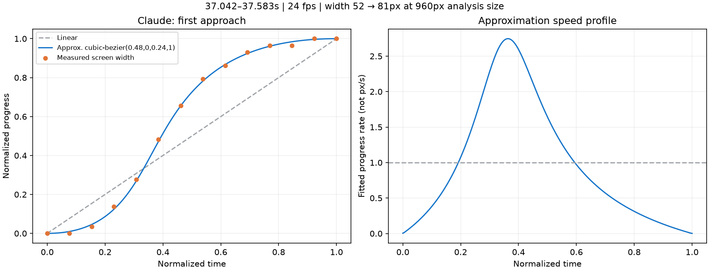
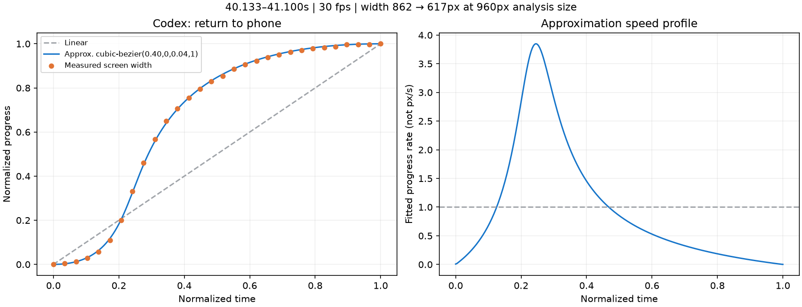
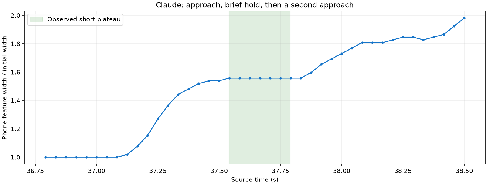

# 画面设计与运动曲线：从参考成片到可试用的参数

这组研究回应用户的重点：学习画面怎样构成，动作怎样起步、加速、减速、停留与接续。内容叙事的学习保留在[产品片方法](product-film-studies.md)，本页补足视觉和运动层。按需使用，不将一组广告变成全局风格。

2026-11-23：在第一轮 8 支影片概览的基础上，对 3 个片段另做 0.1 秒间隔观察；对其中两个可稳定量测的对象，按源视频 24/30fps 分别检查 42/43 帧。第三个心形片段只做状态分析，未拟合角色曲线。原视频、抽帧、标记图留在本地研究目录。本包包含自行制作的量测图、数值和曲线对照页，不包含原片。

## 画面一：控制区与结果区，构成不对称的两点关系

来源：[Introducing Claude Design](https://launchscene.app/v/anthropic-claude-design-by-labs)，重点约 37–38.5 秒。

- **构图与裁切。** 手机预览在左下，控制板在右上；推近后手机下部与左侧工作区出画，控制板仍完整。看见的是“被修改的对象 + 修改它的位置”，不必交代全部软件边框。上下错开比两个等高卡片更能区分职责。
- **主次与留白。** 手机面积较大，控制板面积较小但有指针和色块；动作将注意力从控件送到预览。右下留白让两者保持分离，局部阴影只帮助区别层级。不是靠把每层都抬高、发光来突出焦点。
- **颜色与质感。** 暖灰底、米白面板、低饱和主题色形成接近的底色关系；黑色原生 UI 与指针提供局部高对比。界面变绿是操作反馈，不是任意全片换色。
- **迁移方式。** 在自己的平面图形里安排“操作端 + 响应端”，允许两者大小和高低不同。先设计终态裁切，再反推进入轨迹。保留必要识别区，其余可出画。
- **容易做错。** 整个页面一律居中缩放、始终露全四角；两个面板同大同重；所有部件同时浮动，反而看不见操作结果。

## 画面二：用颜色角色和局部特写，压低背景竞争

来源：[Grok Bot 1.0](https://youtu.be/SZZAKVZO-n8)，重点约 24–27 秒，26 秒状态。

- **构图。** 取景已进入图表内部，标题和部分图例被切出边界；蓝色数据点、箭头、角色与上方提示框形成一个紧凑焦点组。灰色曲线仍在，保留比较参照。
- **视觉层级。** 蓝色串联主曲线、当前节点和行动者；灰色让其他系列退后。角色的白色外缘将它从蓝色曲线及浅蓝填充里分离，不靠持续闪烁。
- **形状关系。** 圆节点、三角箭头和软角色轮廓各有职责，互相区别；统一的是色彩角色和当前事件，不是把所有对象做成同一个圆角矩形。
- **迁移方式。** 给主事件一个稳定的颜色身份，非主事件降低对比；取景接近后仍保留一个参照物。无数据任务可迁移这一注意力组织，但不复制数值和曲线含义。
- **容易做错。** 每根线都高饱和；图表主体、鼠标、角色各自用不同抢眼特效；只放大空白背景而没有重要细节。

## 画面三：让小细节扩大到能改变画面职责

来源：[Grok Bot 1.0](https://youtu.be/SZZAKVZO-n8)，重点约 67.5–69 秒。

心形先是海报下方反馈的一部分，随后进入提示框并被推近，最后成为浅粉底上的大主角。过程中信息密度从图片、文字和数字，变为一个高饱和红形状与大面积留白。轮廓本身非对称，白色眼部倾斜；无需再堆装饰来表现个性。

**取景放大与主体变形是两层动作。** 小心形自身的轮廓和眼部可见性也在变。它的包围盒同时受尺度、形变、可见朝向影响，所以本轮没有将其宽度变化误拟合成一条“缩放曲线”，也不认定作者用了三维或某个特定变形工具。

迁移时可让自己的纸片、符号或照片细节占据更大画面，随职责改变内部形状或姿态。若使用 Logo，身份和可变形范围另核对。不要默认加眼睛、翻面、弹性或居中落版。

## 画面四：稳定构图骨架，释放材料和尺度变化

来源：[Claude 模型揭晓参考](https://x.com/claudeai/status/2119867114450268322)，重点约 0–13 秒。影片名称与链接沿用原对话，不作为模型发布事实的独立认证。

海面、沙丘、发光边缘、点线图形、微观素材之间反复保留相近的弧线走向；弧线位置不是逐像素不变。上方大面积空域与下方带纹理的曲面形成清晰分区，小人物或细小事件成为尺度参照。材料、冷暖、粗细和景别可以变化，观看骨架仍有联系。

可迁移的是**形状、位置和负空间之间的关系**。在自己题目里找斜线、折角、圆孔或边缘，不必继续用宇宙与地平线。匹配成立时，硬切也能连接材料；无需所有切换都做融化、渐变或连续形变。若本题材料没有共同轮廓，换连接线索，不用粒子填补。

## 两条从成片量测得到的曲线

这两条是**屏幕空间标量变化的近似拟合**。没有作者工程，无法恢复唯一的原始关键帧、相机参数或插值方法。测量后按选定区间归一化；区间边界、采样率、压缩和像素量化会影响拟合结果。

| 案例 | 量测对象与范围 | 本轮可观察到的时间分配 | 可试用近似，不是作者原值 |
| --- | --- | --- | --- |
| Claude 第一次推近 | 约 37.042–37.583s，24fps，14 帧；手机黑色顶部特征宽度 52→81px，分析图宽960px | 25%/50%/75% 时间约完成17%/72%/96%尺度变化；启动慢，中段集中变化，尾部收稳 | `cubic-bezier(0.48, 0, 0.24, 1)`，案例窗口约0.54s |
| Codex 回到手机整体 | 约 40.133–41.100s，30fps，30 帧；手机亮色外边界宽度862→617px，分析图宽960px | 25%/50%/75%时间约完成36%/84%/97%宽度变化；较早完成主体变化，尾部较长 | `cubic-bezier(0.40, 0, 0.04, 1)`，案例窗口约0.97s |

来源：[Codex mobile 参考](https://www.youtube.com/watch?v=tk9qrk5G4RQ)。两个片段内未见显著尺度过冲；小于边缘估计误差的波动不能认定为回弹。这个结论不扩展到整部影片或其他运动属性。

图中右栏是拟合函数的进度变化率，不是直接测得的像素速度。样本内归一化 RMSE 约0.9%和0.4%，只说明近似贴合这些样本；第一例总变化仅29px，约1px边缘不确定性已经相当于行程的3.4%，不能把拟合小数当高精度恢复。

初步光流跟踪用于交叉检查，后段有效特征减少，因此最终以手机固定特征和外边界量测为主。Codex 通过五条水平扫描线检查边界一致性，不把内部文字、浅灰面板的变化当成外框缩放。数值与来源可查[量测样本](curve-studies/curve-observations.json)。

## 曲线之外还有分段与停留

Claude 的较长区间约36.79–38.50秒显示：第一次推进后，约37.54–37.79秒之间的特征宽度和位置近似保持，随后又推进。第二段后部仍有变化，本轮没有把它当完整动作拟合。这个观察细化了最初“推进后慢移”的概述：**推进、短停、再推进**比一条从头走到尾的缓出更接近观测结果。

制作时先安排观看任务和动作段，再选择每段曲线。停留是时序的一部分，不为维持“流畅”删除；经过路径节点也不必强制停下。选择整片时长、动作时长和停留时长是三件不同的事。

## 怎样变成制作动作

1. **先做关键画面。** 明确主体占比、第一与第二焦点、对比角色、遮挡层级、裁切线和负空间。决定起态与终态各自为何成立，不能只写“干净、高级”。
2. **区分要动的量。** 分开记录对象位置、取景、尺度、形状、透明度和内部反馈。屏幕里一个物体变大，未必是它的 scale 属性；移动与变形叠加时分开验证。
3. **再决定时间分配。** 标出起动、最快区、收稳、停留和交接。快起、慢起、急停、掠过、过冲各有用途；不默认全片 `easeOut` 或全片弹簧。
4. **映射到当前路程。** `u = clamp((t-start)/duration, 0, 1)`，`q(t)=q0+(q1-q0)*p(u)`。实际速度随行程和时长变化；同一曲线给不同路程不保证同样感受。不同属性若有不同职责，不强制共用同一进度。
5. **检查接点与终态构图。** 先看25%、50%、75%动作状态，再以本题粗动稿检查正常速度。检查主角是否出画、焦点是否交接、尾段是否拖、停留是否有用途；回弹只在测到或表达需要时增加。

本页的 cubic-bezier 是时间到进度的映射。自行实现时先求 `Bx(s)=u`，再取 `By(s)`；直接把 `u` 代进 `By` 会丢掉两个横向控制点的作用。CSS 原生曲线可直接使用；其他引擎依实际 API 接入，不将字符串误传给不支持它的插值函数。使用 DrawAI 的工程组织与导出时，场景动画仍需显式实现、预览核对；这些不是 DrawAI 已验证的内置配方。

[打开可拖动的曲线对照页](curve-studies/curve-lab.html)：比较同一动作在量测样本、拟合曲线和线性进度下的位置。页面中的图形是研究示意，不是原片复刻或审美验证。

## 下一次学习参考时记录什么

用一张小表记录即可，不强制所有项目全面量测：

`原片区间与查看范围｜关键画面的主次、颜色、材质、留白、裁切｜谁在动、哪一属性｜起止状态、阶段与停留｜测量／推测／建议分别是什么｜当前内容怎样改造｜小样验证结果。`

完整视觉学习应同时改变画面和运动的选择。只多加几个缓动预设，或只总结“操作—结果”，都不能替代这两层设计。现有[运动原则](motion-laws.md)与[设计检查](design-review.md)继续适用。这里没有完成原片音轨分析、正常速度完整观看、全部对象曲线测量或新动画的审美验证。
